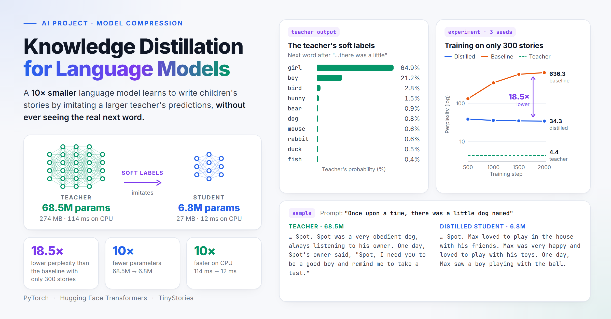
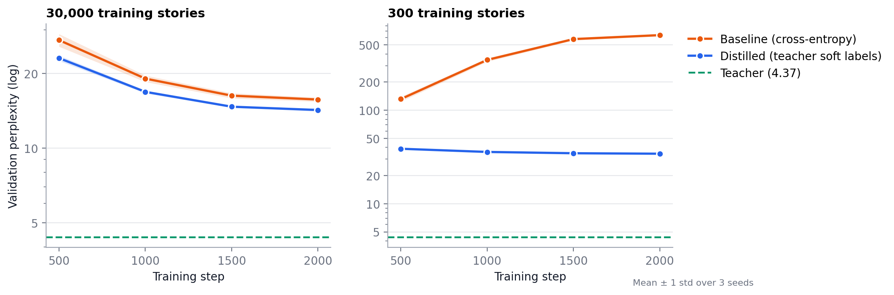
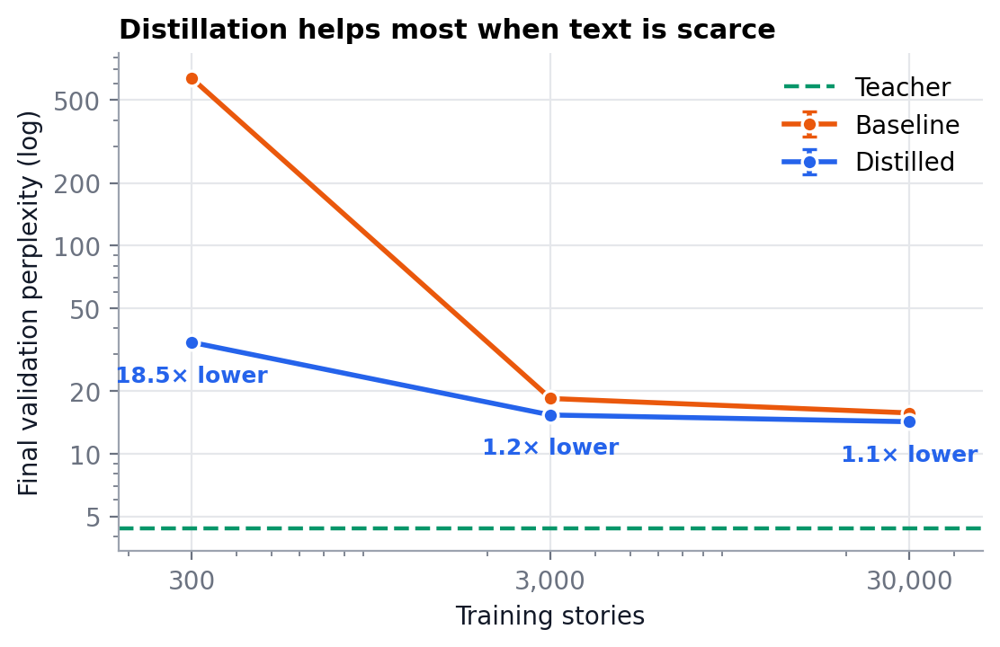
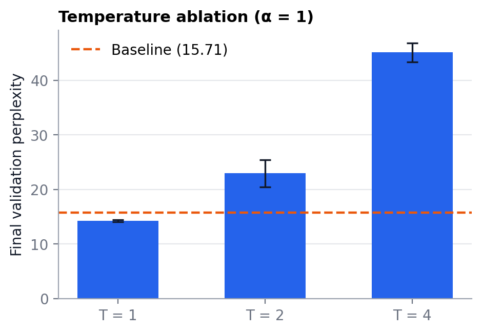
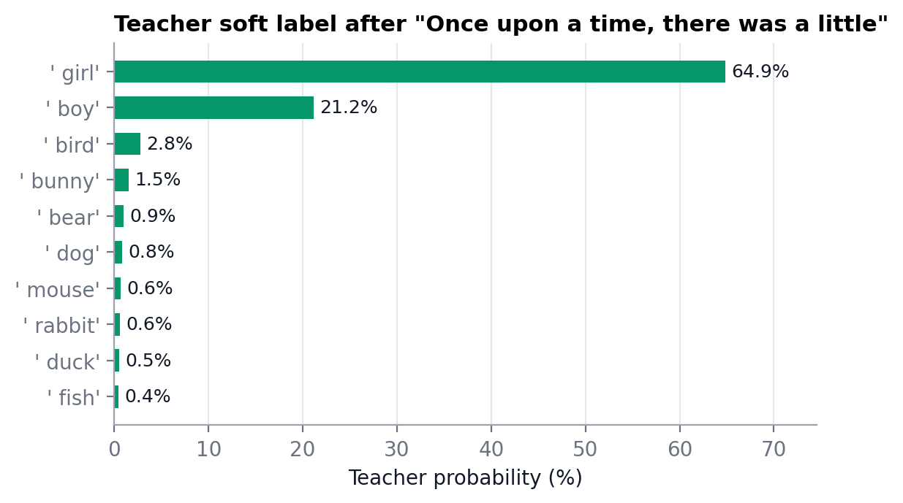

<p align="center">
  
</p>

# Knowledge Distillation for Language Models


This repository compresses a **68.5M-parameter** pretrained language model ([TinyStories-33M](https://huggingface.co/roneneldan/TinyStories-33M)) into a **6.8M-parameter** GPT-2 student. The student is trained **only on the teacher's per-token output distributions**, and it never sees the ground-truth next token.

It is evaluated against a baseline that has the same architecture, initialization, data, batches and optimizer but is trained with ordinary cross-entropy. Every result below is the mean ± std over **3 seeds**, and every number and figure is generated from the logged runs by `scripts/make_report.py`.

## Key results

- **Distillation beats ordinary training at the same size.** Validation perplexity is **14.26 ± 0.17 vs. 15.71 ± 0.30**. The distilled student is better on every one of the 3 paired seeds, its KL to the teacher is 16% lower, and it agrees with the teacher's top token 3.7 points more often.
- **The gain is largest when training text is scarce.** With only 300 stories, the baseline overfits to a perplexity of **636**, while the distilled student reaches **34.3**, an **18.5×** improvement. The teacher's soft labels carry information that 300 stories alone don't provide.
- **The student is 10× smaller and 9.7× faster.** It has 68.5M → 6.84M parameters and a 274 MB → 27 MB checkpoint, and CPU latency drops from 114 ms → 12 ms for a batch of 8 × 64 tokens.
- **T = 1 is clearly best in this setting.** Raising the temperature to 2 or 4 without a hard-label term makes the student worse than the baseline. See the [temperature ablation](#temperature-ablation).

## Results

Validation set: 1,000 held-out chunks of 64 tokens from the TinyStories validation split. Each run is 2,000 steps at batch size 32. Full tables are in [`results/RESULTS.md`](results/RESULTS.md), and per-run logs with full configs are in [`results/runs/`](results/runs).

### Main comparison (30,000 training stories)

| Model | Params | Perplexity ↓ | KL to teacher ↓ | Top-1 agreement ↑ |
|---|---|---|---|---|
| Teacher (TinyStories-33M, frozen) | 68.5M | 4.37 | 0 | 100% |
| Baseline student (cross-entropy) | 6.8M | 15.71 ± 0.30 | 1.519 ± 0.016 | 51.3% ± 0.2% |
| **Distilled student** | 6.8M | **14.26 ± 0.17** | **1.278 ± 0.012** | **55.0% ± 0.4%** |

<p align="center"></p>

### Distillation under data scarcity

| Training stories | Baseline | Distilled | Improvement |
|---|---|---|---|
| 300 | 636.28 ± 17.94 | **34.30 ± 0.53** | 18.5× |
| 3,000 | 18.43 ± 0.05 | **15.36 ± 0.08** | 1.2× |
| 30,000 | 15.71 ± 0.30 | **14.26 ± 0.17** | 1.1× |

<p align="center"></p>

With 300 stories, the baseline gets *worse* the longer it trains, because it memorizes a small corpus and becomes overconfident on new text. The distilled student, trained on the same 300 stories and the same batches, stays stable. Its targets are full distributions from a model that has seen far more text, so they don't collapse to one memorized token.

### Temperature ablation

All runs use pure distillation (α = 1), so only the temperature changes.

| Temperature | Perplexity | KL to teacher |
|---|---|---|
| **1** | **14.26 ± 0.17** | **1.278 ± 0.012** |
| 2 | 22.95 ± 2.49 | 1.696 ± 0.111 |
| 4 | 45.11 ± 1.73 | 2.365 ± 0.037 |

<p align="center"></p>

Higher temperatures are often recommended for classification. Here they hurt, and my interpretation is as follows. With α = 1, the student's only target is the teacher's distribution *at temperature T*. For a 50k-token vocabulary, raising T moves substantial probability mass onto the long tail of implausible tokens. A 6.8M-parameter student then spends its limited capacity matching that tail and is evaluated at T = 1, where the mismatch costs perplexity. A hard-label term (α < 1) would likely recover part of the gap, but that is not tested here.

### What the student learns from

The training signal for one position, the teacher's next-token distribution after *"Once upon a time, there was a little"*:

<p align="center"></p>

A one-hot label says only "girl". The soft label also says that "boy" is very plausible and that small animals are reasonable, and the student receives this richer target at every token position.

### Size and speed

| | Params | Checkpoint (fp32) | CPU latency, 8 × 64 tokens |
|---|---|---|---|
| Teacher | 68.5M | 274 MB | 114 ms |
| Student | 6.84M | 27 MB | 12 ms |
| **Ratio** | **10.0×** | **10.0×** | **9.7×** |

The latency is the median of 20 forward passes after warm-up on an Intel Core i9-14900HX laptop CPU with 24 PyTorch threads ([`results/benchmark.json`](results/benchmark.json)).

### Samples

Both outputs below use the same prompt and sampling seed (`top_k=40`, `temperature=0.8`); more are in [`results/samples.json`](results/samples.json).

> **Teacher (68.5M):** Once upon a time, there was a little dog named Spot. Spot was a very obedient dog, always listening to his owner. One day, Spot's owner said, "Spot, I need you to be a good boy and remind me to take a test." …
>
> **Distilled student (6.8M):** Once upon a time, there was a little dog named Spot. Max loved to play in the house with his friends. Max was very happy and loved to play with his toys. One day, Max saw a boy playing with the ball. …

The student writes fluent, on-domain sentences but loses track of entities (Spot becomes Max). That is expected from a 2-layer model trained for a few minutes.

## Method

**Objective.** At every token position *i*, with student logits $z^s_i$ and teacher logits $z^t_i$:

$$\mathcal{L} = \alpha \, T^2 \, \frac{1}{N}\sum_i \mathrm{KL}\big(\mathrm{softmax}(z^t_i/T)\;\|\;\mathrm{softmax}(z^s_i/T)\big) \;+\; (1-\alpha)\,\mathrm{CE}(z^s, y)$$

The $T^2$ factor keeps gradient magnitudes independent of $T$, so one learning rate works for every temperature; this is verified in [`tests/test_losses.py`](tests/test_losses.py). The headline runs use $\alpha = 1$ and $T = 1$, so they never use the ground-truth tokens $y$.

**Setup.**

| | Teacher | Student |
|---|---|---|
| Architecture | GPT-Neo, 4 layers, d=768, 16 heads | GPT-2, 2 layers, d=128, 4 heads |
| Parameters | 68.5M | 6.84M (94% in the tied token embedding) |
| Training | pretrained, frozen | from scratch, 2,000 steps × 32 × 64 tokens |

The data is the first 30,000 TinyStories training stories (≈ 6.6M tokens), tokenized with the teacher's tokenizer and cut into 64-token chunks. Story subsets for the scarcity experiment are cut at story boundaries.

**Fair comparison.** The baseline and distilled runs share:

- the same student initialization (seeded),
- the same sequence of training batches (a seeded `torch.Generator`),
- the same optimizer (AdamW, lr 2e-3, weight decay 0.01, cosine schedule, gradient clipping at 1.0),
- the same number of steps and the same validation chunks.

Only the loss differs. Every configuration is run with seeds 0, 1 and 2.

**Implementation notes.**

- Teacher and student forward passes run under bfloat16 autocast, while the loss is computed in float32.
- The KL uses `log_target=True` for numerical stability.
- The whole tokenized dataset is kept on the GPU, so batching costs essentially nothing.
- Distilled runs take about 3.1 minutes each on an RTX 4070 Laptop GPU, compared with 1.1 minutes for the baseline. The difference is the teacher's forward pass.

## Reproduce

```bash
pip install -e ".[dev]"          # install PyTorch for your CUDA version first

# One run
python scripts/train.py --config configs/distill.yaml
python scripts/train.py --config configs/baseline.yaml --set train.seed=1 data.num_train_stories=300

# Everything in this README (24 runs, ~60 min on an 8 GB laptop GPU). Finished runs are skipped.
python scripts/run_sweep.py configs/sweeps/main.yaml --save-dir checkpoints --save-seed 0
python scripts/run_sweep.py configs/sweeps/scarce_data.yaml configs/sweeps/temperature.yaml

# Benchmark, teacher soft labels, samples, then tables and figures
python scripts/benchmark.py checkpoints/distill_n30000_T1_a1_s0
python scripts/soft_labels.py
python scripts/generate.py --models teacher checkpoints/distill_n30000_T1_a1_s0 checkpoints/baseline_n30000_s0 --out results/samples.json
python scripts/make_report.py
```

The first run downloads the teacher and 32,000 stories and caches the tokens in `~/.cache/lm-distill`. Any config field can be overridden from the command line with `--set section.field=value`.

## Repository layout

```
configs/                 baseline.yaml, distill.yaml, sweeps/{main,scarce_data,temperature}.yaml
src/lm_distill/
  config.py              typed dataclass config, YAML loading, dotted-key overrides
  data.py                TinyStories download, caching, story-boundary subsets, chunking
  models.py              frozen teacher loading, seeded student construction
  losses.py              distillation loss (temperature, alpha, T² scaling)
  training.py            training loop shared by baseline and distillation
  evaluation.py          perplexity, KL to teacher, top-1 agreement
  benchmark.py           checkpoint size and CPU latency
  runner.py              config → data/models → train → JSON (and optional checkpoint)
scripts/                 train, run_sweep, evaluate, generate, benchmark, soft_labels, make_report
results/                 per-run JSON logs, summary.json, RESULTS.md, figures/
notebooks/results.ipynb  browse all runs and figures (reads results/, no GPU needed)
tests/                   loss correctness, data/config, CPU end-to-end training smoke tests
```

## Tests

```bash
pytest -q          # 14 tests, < 10 s on CPU, no downloads
ruff check .
```

The tests check the loss against a reference KL, the α endpoints, the effect of T² on gradient scale, story-boundary subsetting, that two runs with the same seed are identical, and that distillation lowers a tiny student's KL to a tiny teacher. CI runs lint and tests on every push (`.github/workflows/ci.yml`).

## Limitations

- **One teacher, one dataset, one student size.** The results show the method works in this setting and don't claim more.
- **Hyperparameters weren't tuned per method.** The learning rate, schedule and step count came from early exploration and are shared by both students. Tuning each separately could change the gap at 30k stories, though it's unlikely to close the 18.5× gap at 300 stories.
- **No separate test split.** All numbers are on held-out validation chunks that were never trained on. The shared hyperparameters came from earlier exploration on the same data, so there is no fully untouched test set.
- **Untested combinations.** The temperature ablation uses α = 1 only, and mixed objectives (0 < α < 1) are supported by the code but not reported.
- **Latency on one machine.** CPU latency is measured on a single laptop and will vary with hardware and thread count.

## References

- G. Hinton, O. Vinyals, J. Dean. [Distilling the Knowledge in a Neural Network](https://arxiv.org/abs/1503.02531). 2015.
- R. Eldan, Y. Li. [TinyStories: How Small Can Language Models Be and Still Speak Coherent English?](https://arxiv.org/abs/2305.07759) 2023.
- V. Sanh, L. Debut, J. Chaumond, T. Wolf. [DistilBERT, a distilled version of BERT](https://arxiv.org/abs/1910.01108). 2019.

## Author

**Reza Torabi** · [reza-torabi.com](https://www.reza-torabi.com)

Released under the [MIT License](LICENSE).
